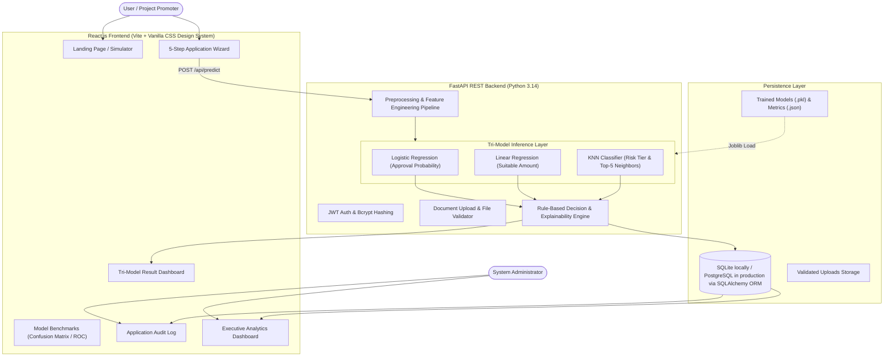
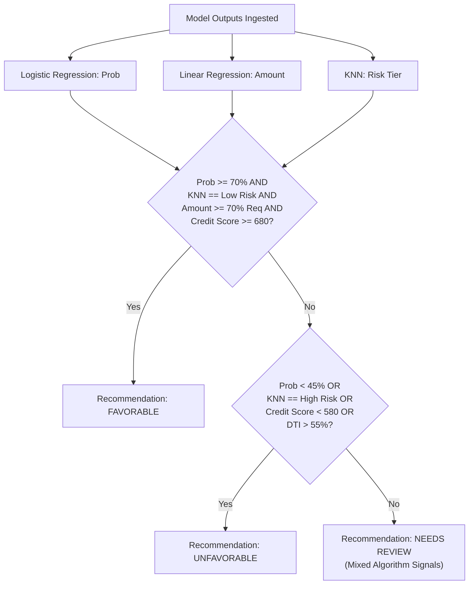
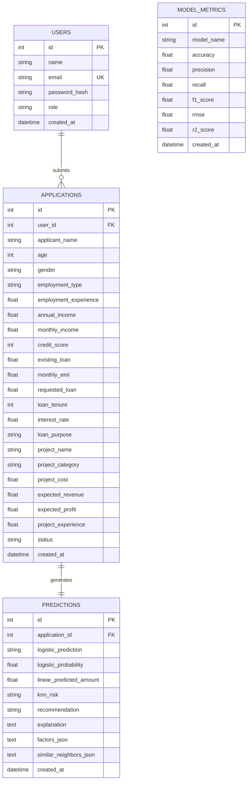

# System Architecture Document

## Machine Learning Based Project Loan Approval System

---

## 1. Executive Summary & Objective

The **Machine Learning Based Project Loan Approval System** is a modern, responsive, full-stack educational web application designed to evaluate commercial and project loan applications through a tri-model machine learning architecture:

1. **Logistic Regression**: Approval Classification & Statistical Probability
2. **Linear Regression**: Suitable Loan Amount & Debt Capacity Prediction
3. **K-Nearest Neighbors (KNN)**: Multi-class Risk Assessment & Historical Cohort Mapping

The architecture combines automated data validation, rigorous feature engineering, multi-algorithm inference, a transparent rule-based decision engine, and an executive administration dashboard.

> [!IMPORTANT]
> **Educational Disclaimer**: This system is built for educational, academic (B.Tech CSE / Hackathon), and demonstrative purposes. Model recommendations are statistical estimations and do not represent actual institutional banking or legal lending decisions.

---

## 2. High-Level System Architecture

---

## 3. Machine Learning Algorithms & Mathematical Formulation

### A. Logistic Regression (Binary Approval Classifier)
* **Target ($y$):** `loan_approved` $\in \{0, 1\}$
* **Activation Function:** Sigmoid function $\sigma(z) = \frac{1}{1 + e^{-z}}$ where $z = \beta_0 + \sum_{i=1}^n \beta_i X_i$
* **Output:** Predicted class ("Approved" vs "Not Approved") and probability $P(y=1|X) \in [0.0, 1.0]$.
* **Optimization:** L-BFGS with L2 regularization ($C = 1.0$).

### B. Linear Regression (Suitable Debt Capacity Prediction)
* **Target ($y$):** `approved_loan_amount` (continuous float in INR)
* **Formulation:** $\hat{y} = \beta_0 + \beta_1 X_1 + \dots + \beta_n X_n$
* **Purpose:** Prevents borrower over-leveraging by aligning requested funding with project revenue, profit margins, and existing debt commitments.
* **Evaluation Metrics:** Mean Absolute Error (MAE), Root Mean Squared Error (RMSE), and Coefficient of Determination ($R^2$).

### C. K-Nearest Neighbors (Multi-Class Risk Cohort)
* **Target ($y$):** `risk_level` $\in \{\text{"Low Risk"}, \text{"Medium Risk"}, \text{"High Risk"}\}$
* **Distance Metric:** Minkowski distance ($p=2$, Euclidean space):
  $$d(x, x') = \sqrt{\sum_{i=1}^n (x_i - x_i')^2}$$
* **Neighborhood ($K=5$):** Evaluates the 5 closest historical project applications in scaled feature space to extract empirical risk consensus and similarity distances.

---

## 4. Feature Engineering & Preprocessing Pipeline

The preprocessor is structured as an immutable Scikit-Learn `ColumnTransformer`:

1. **Numerical Features:** Scaled using `StandardScaler` ($\mu=0, \sigma=1$):
   * `age`, `employment_experience`, `annual_income`, `monthly_income`, `credit_score`, `existing_loan`, `monthly_emi`, `project_cost`, `expected_revenue`, `expected_profit`, `project_experience`, `requested_loan`, `loan_tenure`, `interest_rate`.
2. **Domain Financial Ratios (Engineered):**
   * **Debt-to-Income (DTI):** $\frac{\text{monthly\_emi}}{\text{monthly\_income}}$
   * **Loan-to-Project-Cost (LTV):** $\frac{\text{requested\_loan}}{\text{project\_cost} + 1}$
   * **Loan-to-Income:** $\frac{\text{requested\_loan}}{\text{annual\_income} + 1}$
   * **Profit-to-Loan Coverage:** $\frac{\text{expected\_profit}}{\text{requested\_loan} + 1}$
3. **Categorical Features:** Encoded via `OneHotEncoder(handle_unknown='ignore', sparse_output=False)`:
   * `gender`, `employment_type`, `project_category`, `loan_purpose`.

---

## 5. Decision Synthesis & Explainability Engine

Rather than trusting a single algorithm in isolation, the decision engine synthesizes all 3 model predictions with transparent rules:

### Explainability Narrative Generation
For every application, the engine produces:
* A plain-language narrative explaining the agreement or divergence across the three algorithms.
* Factor importance breakdown classifying Credit Score, DTI, Profitability, and Equity commitment into `Positive`, `Warning`, or `Negative` impacts.

---

## 6. Database Schema (Entity Relationship)

